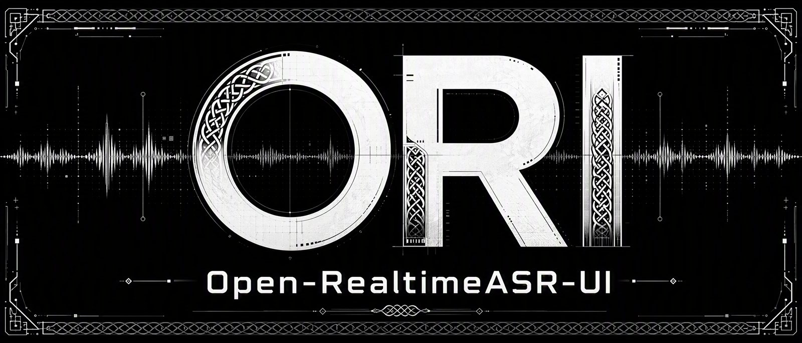

<p align="center">
  
</p>

<div align="center">

# Open-RealtimeASR-UI (ORI Voice)

</div>

<div align="center">

   [](https://github.com/LangeHeris/Open-RealtimeASR-UI/releases)

</div>

<div align="center">

[简体中文](README.md) | **English**

</div>

<div align="center">

[](https://github.com/LangeHeris/Open-RealtimeASR-UI/releases/latest/download/ORI-win64.zip) [](https://store.steampowered.com/app/5295220/) [](https://github.com/LangeHeris/Open-RealtimeASR-UI/releases)

</div>

***

<div align="center">
  
</div>

## About

**Open-RealtimeASR-UI (ORI) is a real-time voice input method for Windows**: press a global hotkey, start talking, and your words appear at the cursor in real time — in any text field, games included. It is an open-source alternative to Windows built-in Voice Typing (Win+H).

Its core design is **no engine lock-in, dictation behavior is yours to define**: four high-accuracy real-time streaming cloud recognition engines, plus the offline local FunASR engine (Paraformer-zh-streaming) — switch them and the text injection method freely from the right-click menu. Around the dictation pipeline it offers AI features, voice commands and AI real-time voice conversation, each toggleable on demand.

> Headphones are recommended to keep speaker echo from interfering with recognition. For the complete guide see the [User Manual](docs/User_Doc_en.md) — demo video: [Bilibili](https://www.bilibili.com/video/BV1yAaV68Evr)

 

## Quick Start

### Requirements

- Windows 10 / 11
- Source build: Python 3.10+

### Run in Three Steps

The steps below run from source. For the packaged build, extract the archive and double-click `ORI.exe`; no environment setup is needed.

```bash
# 1. Clone the repo
git clone https://github.com/LangeHeris/Open-RealtimeASR-UI.git
cd Open-RealtimeASR-UI

# 2. Install dependencies
pip install -r requirements.txt

# 3. Launch
python run.py
# or: python -m asr_voice.main (ModuleNotFoundError on isolated Python with _pth — fall back to run.py)
# double-click start.bat to have it pick a usable Python automatically
```

### First-Run Setup

1. The first launch auto-generates `config.yaml` (packaged build: next to the exe; source build: under `config/`)
2. The default engine is Alibaba Cloud Model Studio: enter at least one cloud provider's key under Settings → Engine Keys **(every provider offers a free trial quota)**, or right-click and switch to the local FunASR engine (install funasr first, see below)
3. Focus any text field, press `Ctrl+G` and speak; press again to stop and the text is typed automatically

For the full first-run walkthrough see Chapter 3 of the [User Manual](docs/User_Doc_en.md); for every configuration field with comments see [config/config.example.yaml](config/config.example.yaml).

## Speech Engines

### Cloud Engines

Four cloud engines plus one local engine, grouped by tier in the right-click menu (Tencent Cloud 3 tiers / Alibaba Cloud 2 / iFLYTEK 2 / Volcengine 2). The model bound to each tier and its visibility can be adjusted in Settings:

| Engine | Model / version | Keys | Notes |
| :-- | :-- | :-- | :-- |
| Alibaba Cloud Model Studio (default) | General engine `paraformer-realtime-v2`; LLM edition `qwen-audio-3.0-asr-flash-streaming` | `api_key` | Filler-word filtering, hotword lists, language hints |
| Tencent Cloud | Three configurable tiers: LLM 2.0 (default `16k_zh_en_2.0`) / LLM 1.0 (`16k_zh_en`) / general engine (`16k_zh`); direct call defaults to `Hy-ASR-3.0-preview` | `secret_id` + `secret_key` + `app_id` | The model each tier actually calls can be changed in Settings; supports punctuation / digit / profanity / filler-word filtering |
| iFLYTEK | LLM edition `autodialect` (Mandarin + English + 202 dialects); Standard edition Chinese / English | LLM edition: `app_id`+`api_key`+`api_secret`; Standard: `std_app_id`+`std_api_key` | The two editions use separate keys that are not interchangeable |
| Volcengine | Doubao 2.0 (`seedasr`) / 1.0 (`bigasr`); the two generations are billed and configured independently | New: `api_key`; legacy: `app_id`+`access_token` | Two-pass recognition + semantic smoothing (DDC) |
| Local FunASR | `paraformer-zh-streaming` | **No key needed** | Fully offline and free; runs on CPU or GPU |

> Cloud engines must be activated at your own expense in each provider's console (all offer free trial quotas); local FunASR is completely free and offline.
>
> **The GitHub Release packaged build (exe) does not include the local FunASR engine**: funasr + torch are too large to bundle. The Steam edition bundles it, and the source build can install it (see below).
>
> Per-engine parameter configuration: see Chapter 6 of the [User Manual](docs/User_Doc_en.md).

### Local Engine: FunASR

> **The Steam edition includes the FunASR engine, model weights and dependencies**: offline recognition works right after installation, with no Python environment, pip install or model download required.

The `pip` steps below apply to the source build:

```bash
# CPU
pip install funasr torch torchaudio

# GPU (CUDA 11.8 example)
pip install torch torchaudio --index-url https://download.pytorch.org/whl/cu118
pip install funasr
```

- Model weights are neither bundled nor distributed in this repo: they download automatically from ModelScope on first use (~900 MB, cached in `~/.cache/modelscope/`). You can also point `funasr.local_dir` at a model directory you downloaded yourself; the download channel `funasr.model_hub` can be `ms` (ModelScope) or `hf` (HuggingFace)
- The model warms up in the background at launch and the floating bar notifies you when it is ready; recognition window options: default 600 ms / low-latency 480 ms / high-accuracy 720 ms
- The local engine is available in the source build and the Steam edition; the GitHub Release packaged build (exe) does not include funasr + torch. For offline use in the source build, download the model in advance

Details: [User Manual](docs/User_Doc_en.md) §3.3.

## Voice Mode

Beyond dictation, press `Ctrl+Shift+H` to enter end-to-end voice conversation (Settings → Voice Mode):

| Backend | Config value | Notes |
| --- | --- | --- |
| Doubao S2S (default) | `doubao` | Volcengine end-to-end speech model: recognition, understanding and spoken replies in one. Two model tiers — O2.0 general chat / SC2.0 role-play — 7 official voices, and you can barge in at any time while the AI is speaking |
| Alibaba Cloud Model Studio Qwen-Audio | `aliyun` | Qwen-Audio Realtime end-to-end speech model: plus / flash tiers, 5 official voices, web search support |
| Hermes Agent (self-hosted) | `hermes` | Self-hosted hermes-agent API server: text-only replies; segmentation and recognition happen on your machine (dedicated dialog ASR); press the hotkey while it is thinking to cancel the current turn; no billing |

Conversation behavior:

- **Enter / exit**: press the dialog hotkey, or tick "Voice chat" in the right-click menu; saying "exit / goodbye" to the AI also ends it
- **Interruption**: Doubao / Qwen are full-duplex by default — just start talking while the AI speaks to interrupt it; Hermes is turn-based (always half-duplex)
- **Text**: with Doubao / Qwen the text is revealed at a fixed steady rate (base about 6 characters/second, following the speech-rate setting); Hermes has no audio and shows text as it is generated
- **Memory**: Doubao supports cross-session memory (resumes the last 20 turns); Qwen remembers within a single session; Hermes resumes the same session across runs by default, and the server compresses the context as the window fills (you can also switch to a new session every N turns in Settings)
- **Billing**: Doubao / Qwen are billed by each provider's rules; Hermes is self-hosted for your own use, with no billing

Provider keys, models, personas and behavior differences: see Chapter 9 of the [User Manual](docs/User_Doc_en.md).

## Documentation

- **[User Manual](docs/User_Doc_en.md)**: the complete guide — installation and first-run setup, UI overview, engine configuration, AI correction, voice commands, real-time voice conversation, settings pages, configuration fields, FAQ and troubleshooting

- **[Config template](config/config.example.yaml)**: every configuration field with comments; the config file lookup order and a quick reference of common fields are in Chapter 12 of the User Manual

- **[Contributing guide](CONTRIBUTING.md)**: development environment, code structure conventions and commit guidelines

- **[Third-party notices](THIRD_PARTY_NOTICES.md)**: full list of third-party components, copyright attributions and commercial compliance notes

## Project Layout

```
asr_voice/
├── asr/            # ASR engine wrappers + voice dialog
├── audio/          # mic capture, VAD, dialog playback, pause-media / global-mute while recording
├── config/         # config defaults and loading
├── core/           # main app, recognition pipeline, dialog controller, voice commands, history, autostart, elevation, pre-recording noise-floor calibration
├── input/          # text injection
├── postprocess/    # AI correction
└── ui/             # floating bar, settings UI, theme system, fonts
config/             # config template config.example.yaml
themes/             # extension theme pack library
fonts/              # bundled fonts (local/channel builds only, not in the public repo; falls back to system fonts when absent)
docs/               # documentation
```

## Downloads

- **Source**: clone this repo and follow the [Quick Start](#quick-start); local FunASR models are downloaded by the user

- **Packaged build**: **[download the latest](https://github.com/LangeHeris/Open-RealtimeASR-UI/releases/latest/download/ORI-win64.zip)** — past versions, release notes and checksums are on the [Releases](https://github.com/LangeHeris/Open-RealtimeASR-UI/releases) page; does not include the local engine or its dependencies.

- **Steam edition**: **[View ORI Voice on Steam](https://store.steampowered.com/app/5295220/)** — Steam handles installation and updates for you, with the offline Chinese recognition engine FunASR and its dependencies built in. Also includes Steam Workshop content (supporting the same feature extensions as the open-source build), Steam Cloud, Stats and an exclusive pixel-art theme.

  > The Steam edition is a paid release: one way to support the developer, with the added conveniences of the Steam platform. Cloud engines and AI features are enabled by a Workshop feature pack.

## Privacy

- Cloud recognition engines: recorded audio and recognition results are sent to the cloud provider you configured (Alibaba Cloud / Tencent Cloud / iFLYTEK / Volcengine); please review each provider's privacy policy yourself

- Local FunASR engine: audio and recognition stay entirely on your machine; nothing is uploaded

- AI correction / AI commands: recognized text is sent to the LLM endpoint you configured (OpenAI-compatible); please assess this yourself

- Real-time voice conversation: Doubao / Alibaba Cloud Qwen send audio and text to their respective cloud providers; Hermes sends them to the server you host yourself (recognition still uses the engine you configured)

- History, custom phrases and prompt versions are stored only in the local state directory (`~/.asr_voice/`, or `.asr_voice/` next to the exe)

## Contact

[](https://space.bilibili.com/3492318/dynamic)

## Support the Project

| Alipay | WeChat Pay |
| --- | --- |
|  |  |

## License and Disclaimer

This project is open source under the [Apache License 2.0](LICENSE).

- The cloud recognition engines (Alibaba Cloud Model Studio / Tencent Cloud / iFLYTEK / Volcengine Doubao) are official services of their respective vendors: you must supply your own keys and **activate them at your own expense** under each vendor's billing rules, and you bear all resulting costs and compliance responsibilities.
- This project calls these services through their official APIs; vendor API changes may temporarily make the corresponding engine unavailable — refer to each vendor's latest documentation.
- Channel builds and locally packaged builds bundle [Alibaba PuHuiTi 3.0](https://www.iconfont.cn/fonts/detail?cnid=adI1E7HF7yme) (55 Regular / 65 Medium / 85 Bold) as the default UI font; the GitHub Release CI artifact **does not bundle any font** (the `fonts/` directory is not committed) and the UI falls back to system fonts. The font is published by Alibaba Group, which retains copyright, and is **permanently free for commercial use** for everyone (individuals and enterprises alike, no attribution required). This project distributes the official font files verbatim, with no modification, conversion or sublicensing. See [THIRD_PARTY_NOTICES.md](THIRD_PARTY_NOTICES.md) for the license notes and the official statement link.
